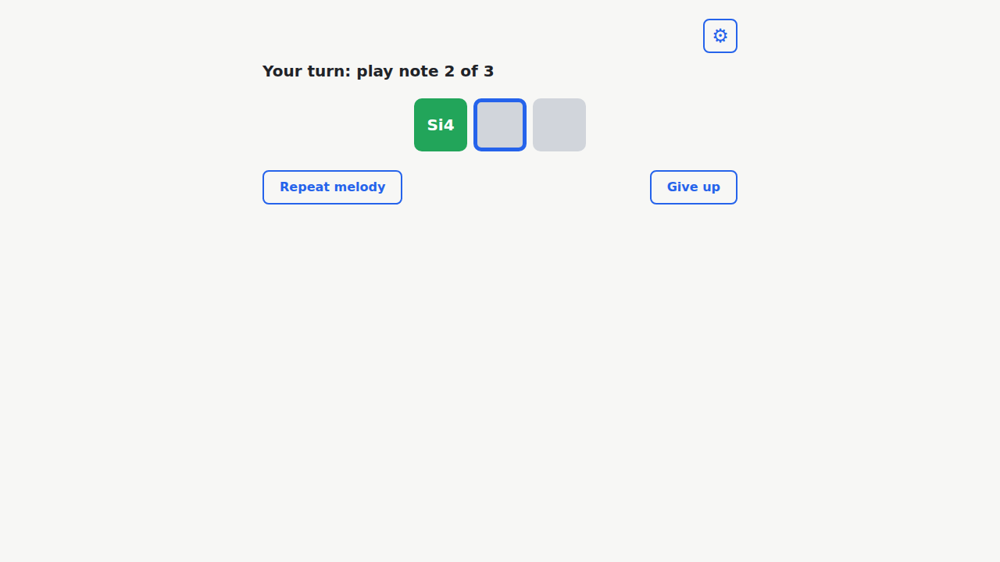
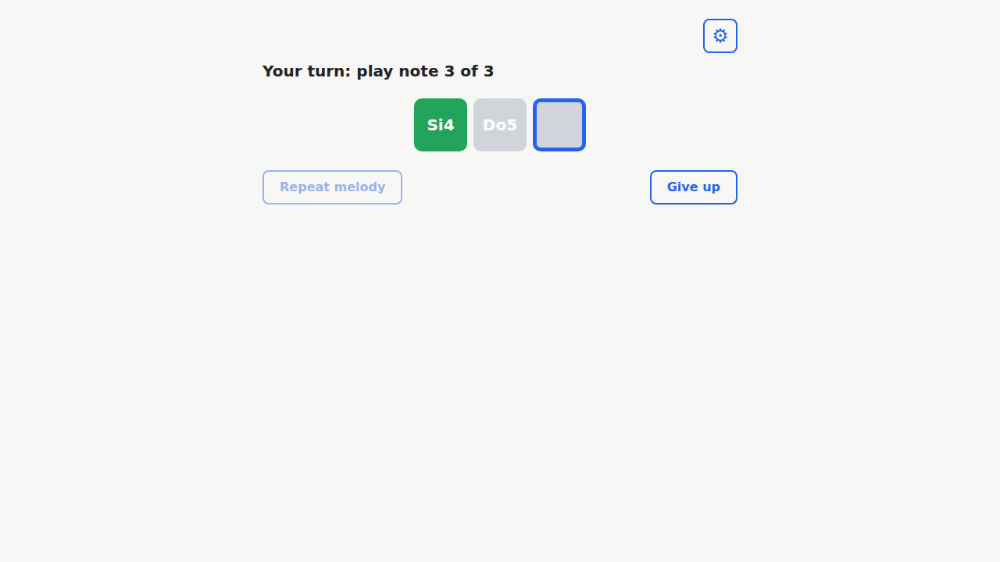
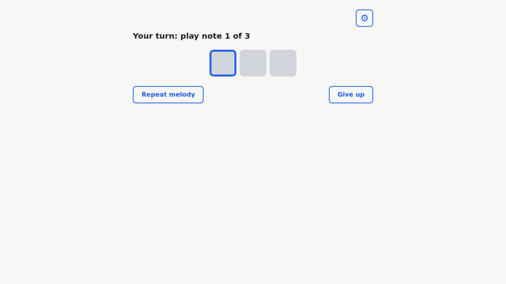
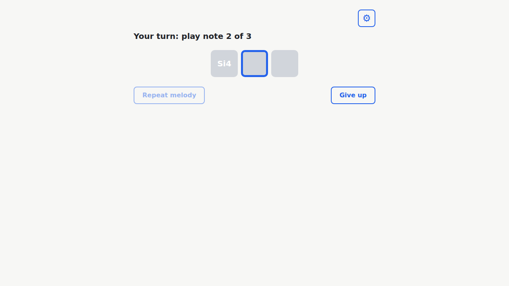
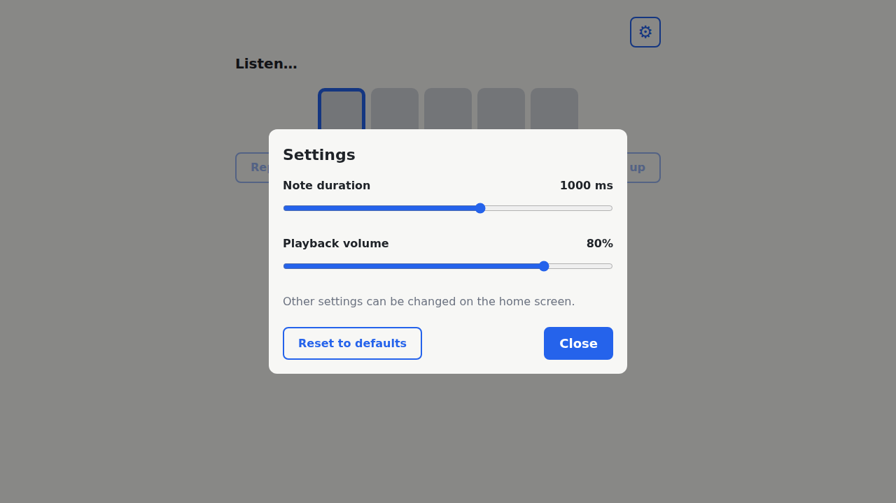
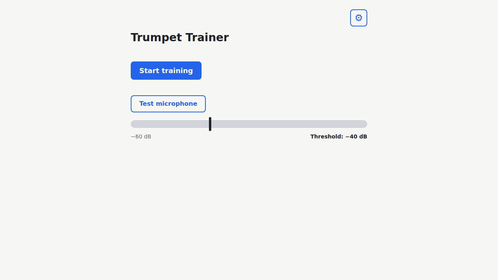
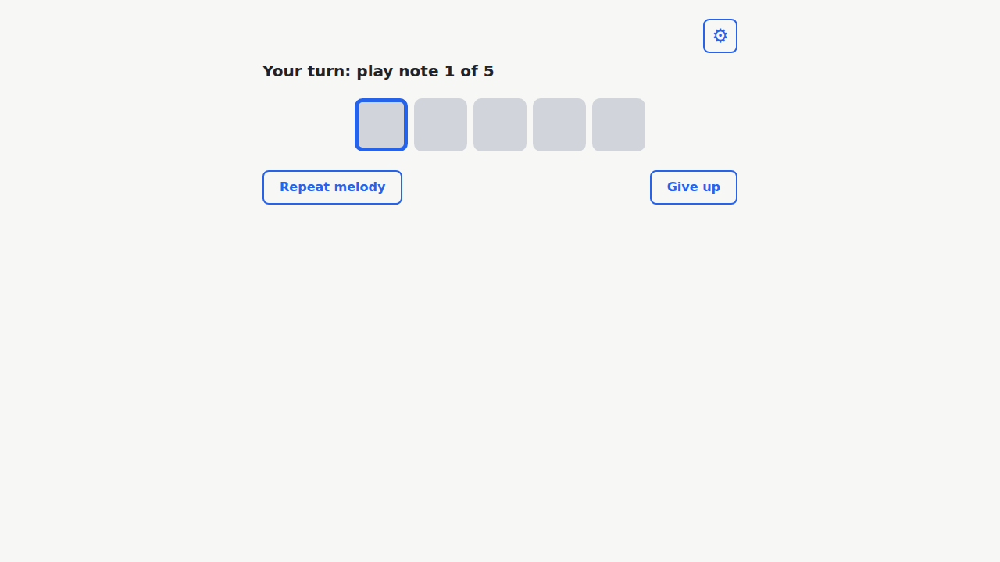

# Validation Report — Run 1

**Run:** 2026-10-25 13:37:31 UTC (finished 2026-10-25 13:38:44 UTC)
**Checklist:** specs/pitch-feedback-graph/validation.md (prd.md, Part 1)
**Browser:** Chromium 153.0.8010.12 (Playwright, headless)

**Summary:** 26 passed, 0 failed, 0 skipped (of 26)

## Method

- Steps 1–14 run the exact Action expressions of the checklist in the page of the dev server (http://localhost:5173/,
  which serves `/src/...` as ES modules) and compare the result with the Expected value (canonical JSON). Step 12 compares
  only what the checklist specifies (at now 600 the dot is not part of the expectation).
- Steps 15–26 drive the real app in Chromium. The microphone is **synthetic**: an init script replaces
  `navigator.mediaDevices.getUserMedia` for audio requests with a `MediaStream` from a separate AudioContext
  (sine OscillatorNode → GainNode 0.5 / 0 for silence → MediaStreamAudioDestinationNode, plus an LFO on `detune` for
  vibrato). Frequency, silence, vibrato and on/off patterns change during a session. The app's own AudioContext, analyser,
  level gate, detector, smoother, hold tracker and reducer are unchanged and process that stream as they would a real mic.
- Timings are measured in the page (`performance.now()`, MutationObserver + 10 ms polling) from the moment the tone
  changes to the DOM commit; tolerances are noted per step. The synth is instrumented (master gain and oscillators are
  recorded) to read the random melody's frequencies and to observe live volume ramps.
- **Not covered here (manual check):** a real trumpet (attacks, tone colour, intonation drift), a speaker + room
  microphone with room noise and the threshold slider, and other browsers/devices. A pure sine is an easy signal for
  the detector; real-instrument behaviour remains a human check.

## Constants

✅ **1. New constants**

Actual `[100,500,50,1000,50,0.8,12.5,320,200,6]` matches the expected value.

Output: [01-constants-new.txt](run-1/output/01-constants-new.txt)

✅ **2. Existing constants unchanged**

Actual `[25,500,-40]` matches the expected value.

Output: [02-constants-unchanged.txt](run-1/output/02-constants-unchanged.txt)

## Note helpers

✅ **3. hzToMidi**

Actual `[69,57,"69.1176","69.2539"]` matches the expected value.

Output: [03-hz-to-midi.txt](run-1/output/03-hz-to-midi.txt)

✅ **4. nearestMidi (ties up) and centsOffset**

Actual `[[70,69,68,69],[-50,-50,25,49]]` matches the expected value.

Output: [04-nearest-midi-cents-offset.txt](run-1/output/04-nearest-midi-cents-offset.txt)

## Pitch smoother

✅ **5. Smoother: first reading unchanged, then EMA**

Actual `[69,"69.3297"]` matches the expected value.

Output: [05-smoother-ema.txt](run-1/output/05-smoother-ema.txt)

✅ **6. Smoother: a gap resets it**

Actual `[null,70]` matches the expected value.

Output: [06-smoother-gap-reset.txt](run-1/output/06-smoother-gap-reset.txt)

✅ **7. Smoother: frame-rate independent**

Actual `["69.8647","69.8647"]` matches the expected value.

Output: [07-smoother-frame-rate.txt](run-1/output/07-smoother-frame-rate.txt)

## Hold tracker

✅ **8. Hold tracker: progress and a single completion at 500 ms**

Actual `[[240,0.48,null],[500,1,69]]` matches the expected value.

Output: [08-hold-tracker-progress.txt](run-1/output/08-hold-tracker-progress.txt)

✅ **9. Hold tracker: a wrong note never fills or completes**

Actual `[null,0]` matches the expected value.

Output: [09-hold-tracker-wrong-note.txt](run-1/output/09-hold-tracker-wrong-note.txt)

✅ **10. Hold tracker: any note completes (octave included)**

Actual `[500,57]` matches the expected value.

Output: [10-hold-tracker-octave.txt](run-1/output/10-hold-tracker-octave.txt)

## Pitch graph model and view

✅ **11. Graph band half-height and guide levels**

Actual `[0.5,[-0.75,-0.5,-0.25,0.25,0.5,0.75]]` matches the expected value.

Output: [11-graph-band-guides.txt](run-1/output/11-graph-band-guides.txt)

✅ **12. Graph Fa/Mi/Fa trail (idea §4.3)**

Actual `[[65,[["0.080,0.00","0.232,-1.00"],["0.632,-1.00","0.800,0.00"]],{"x":0.8,"y":0}],[64,[["0.472,1.00","0.800,0.00"]],{"x":0.8,"y":0}]]` matches the expected value.

Output: [12-graph-fa-mi-fa.txt](run-1/output/12-graph-fa-mi-fa.txt)

✅ **13. Graph centre and red persist through silence**

Actual `[70,{"segments":[],"dot":null,"bandState":"red","fill":0}]` matches the expected value.

Output: [13-graph-silence-persistence.txt](run-1/output/13-graph-silence-persistence.txt)

✅ **14. Graph band-state precedence**

Actual `["green 0","red 0","filling 0.4","idle 0"]` matches the expected value.

Output: [14-graph-band-state.txt](run-1/output/14-graph-band-state.txt)

## Correct note: reveal pause (app, e2e mode)

✅ **15. Correct note: box green after ~0.5 s, status advances at once**

Box 1 turned green ("Si4") 572 ms after the 440 Hz tone started (expected ~500 ms, accepted 400–1200 ms). Status in the same DOM commit: "Your turn: play note 2 of 3" (expected "Your turn: play note 2 of 3").

Output: [15-reveal-timing.txt](run-1/output/15-reveal-timing.txt)

✅ **16. Reveal pause: Repeat disabled, Give up enabled, then Repeat back**

At green: Repeat disabled=true, Give up disabled=false; 200 ms later: Repeat disabled=true, Give up disabled=false; Repeat enabled again 507 ms after the green (expected ~500 ms, accepted 350–1000 ms).

Output: [16-reveal-buttons.txt](run-1/output/16-reveal-buttons.txt)

✅ **17. Continuous tone: boxes ~1 s apart, not every 0.5 s**

Continuous 440 Hz: box 1 after 554 ms, then intervals 1017 ms and 1033 ms (expected ~1 s = 0.5 s hold + 0.5 s reveal; accepted 850–1500 ms, i.e. clearly not every 0.5 s).

Output: [17-continuous-tone-timing.txt](run-1/output/17-continuous-tone-timing.txt)

✅ **18. Last note: "Well done!" at once, Home ~2 s later**

Status in the commit where box 3 turned green: "Well done!" (expected "Well done!"); Home 2005 ms after the last green (expected ~2000 ms, accepted 1700–3000 ms).

✅ **19. Give up during the reveal pause**

Clicked Give up 150 ms after the green (inside the reveal: Repeat disabled=true); Home after 3 ms (expected at once, ≤ 300 ms); still Home 3 s later: true; no page/console errors.

Output: [19-give-up-during-reveal.txt](run-1/output/19-give-up-during-reveal.txt)

## Wrong note (app, e2e mode)

✅ **20. Wrong note (440 Hz for Do5) does not advance**

After 2 s of 440 Hz on note 2 (Do5): boxes done/active/pending, status "Your turn: play note 2 of 3" (expected box 2 still active, "Your turn: play note 2 of 3"). Red marks are Part 2 and not checked.

Output: [20-wrong-note-440-for-do5.txt](run-1/output/20-wrong-note-440-for-do5.txt)

✅ **21. Right note (466.16 Hz) accepted as Do5**

466.16 Hz: box 2 green ("Do5") after 630 ms (expected ~500 ms, accepted 400–1500 ms); status "Your turn: play note 3 of 3".

Output: [21-right-note-466.txt](run-1/output/21-right-note-466.txt)

✅ **22. Octave error (220 Hz for Si4) does not advance**

After 2 s of 220 Hz: boxes active/pending/pending, status "Your turn: play note 1 of 3" (expected nothing advances). Control: 440 Hz then accepted after 578 ms.

Output: [22-octave-error-220.txt](run-1/output/22-octave-error-220.txt)

✅ **23. Repeat while stuck keeps progress; fresh 0.5 s hold**

Stuck before Repeat: boxes done/active/pending. Repeat replayed [440, 466.16, 466.16] Hz (expected [440, 466.16, 466.16]); box 1 during replay: done, at listening: done. With 466.16 Hz sounding throughout the replay, box 2 turned green 513 ms after listening resumed (fresh hold expected ~500 ms, accepted 400–1200 ms) as "Do5".

Output: [23-repeat-keeps-progress.txt](run-1/output/23-repeat-keeps-progress.txt)

## Smoothing (app)

✅ **24. Vibrato / unsteady tone still accepted**

440 Hz with ±12 c vibrato at 5 Hz: accepted after 548 ms (expected ~500 ms, accepted 400–1200 ms).

Output: [24-vibrato.txt](run-1/output/24-vibrato.txt)

✅ **25. A gap in the middle restarts the hold**

After 300 ms tone / 150 ms silence / 300 ms tone: boxes active/pending/pending (expected no acceptance); then a continuous tone was accepted after 563 ms (expected ~500 ms, accepted 400–1200 ms).

Output: [25-gap-restarts-hold.txt](run-1/output/25-gap-restarts-hold.txt)

## Regressions

✅ **26. Regressions: live volume, full random exercise, production preview**

Live volume (5173, during "Listen…"): slider 50% → 80%; the running playback's master gain ramped to 0.8 (initial 0.5); playbacks before/after 2/2 (no restart); training dialog shows 2 sliders. OK.

Full random exercise (5 notes, concert 261.63, 349.23, 293.66, 349.23, 174.61 Hz, written Re4 Sol4 Mi4 Sol4 Sol3): each note accepted after 565/1032/1033/1032/1034 ms (later notes include up to the 500 ms reveal pause); "Well done!", Home 2014 ms after the last green. No errors. OK.

Preview (http://localhost:4173/trumpet-trainer/): assets index-CYNh2I48.js, index-DGZQ-Oh2.css loaded, no 4xx/5xx or errors; Start played 5 notes and reached "Your turn: play note 1 of 5". OK.

Output: [26-dev-volume-and-play-through.txt](run-1/output/26-dev-volume-and-play-through.txt), [26-preview.txt](run-1/output/26-preview.txt)

