# Validation Report — Run 2 (Part 2: prd2.md + re-run of Part 1)

**Run:** 2026-10-26 18:55:10 UTC (finished 2026-10-26 18:59:12 UTC)
**Checklist:** specs/pitch-feedback-graph/validation.md (Human Validation — prd.md, steps 1–26; Human Validation — prd2.md, steps 1–34)
**Browser:** Chromium 153.0.8010.12 (Playwright, headless)

**Summary:** 58 passed, 0 failed, 2 skipped (of 60)

## Method

- Part 1 steps 1–14 run the exact Action expressions of the checklist in the page of the dev server (http://localhost:5173/,
  which serves `/src/...` as ES modules) and compare the result with the Expected value (canonical JSON).
- Every app step drives the real app in Chromium. The microphone is **synthetic**: an init script replaces
  `navigator.mediaDevices.getUserMedia` for audio requests with a `MediaStream` from a separate AudioContext
  (sine OscillatorNode → GainNode 0.5 / 0 for silence → MediaStreamAudioDestinationNode, plus an LFO on `detune` for
  vibrato and exponential frequency ramps for slides). The app's own AudioContext, analyser, level gate, detector,
  smoother, hold tracker, reducer, graph store and components are unchanged and process that stream as a real mic.
- Part 2 observes the DOM: a MutationObserver records a snapshot at every commit (`data-band-state`, fill width, dot
  `cx`/`cy`, trail polyline points, card text, overlay `role="status"` region text, status, boxes, button states) with
  `performance.now()` timestamps; tone changes are timestamped markers in the same log. Viewbox units: 320 × 200, the
  dot sits at x 256 (80 %), cy = 100 − 2 × cents (±50 c = top / bottom edge), band = y 50..150 (±25 c).
- Colours are read with `getComputedStyle` and compared with the `--color-graph-*` / `--color-reveal-*` tokens parsed
  from `src/styles.css` (light `:root`, dark `@media (prefers-color-scheme: dark)`); themes, reduced motion and the
  320 px viewport are emulated with Playwright context options. Clicks through the overlay use real mouse events at
  the button's coordinates (no `force`). The synth is instrumented (master gain, oscillator frequencies and start
  times) to read random melodies, the note duration and live volume ramps.
- **Manual (SKIP):** P2-33 (real iOS Safari / Android Chrome phone) and P2-34 (real screen reader); their details list
  the partial automated evidence. **Out of scope for every item:** a real trumpet (attacks, tone colour, intonation
  drift), a speaker + room microphone with room noise and the threshold slider, and other browsers. A pure sine is an
  easy signal for the detector; real-instrument behaviour remains a human check.

## Re-run of original checks (prd.md)

Step 20's checklist wording "No visual red mark yet (that is Part 2)" is obsolete since Part 2; it is judged only on "nothing advances".

### Constants

✅ **1. New constants**

Actual `[100,500,50,1000,50,0.8,12.5,320,200,6]` matches the expected value.

Output: [P1-01-constants-new.txt](run-2/output/P1-01-constants-new.txt)

✅ **2. Existing constants unchanged**

Actual `[25,500,-40]` matches the expected value.

Output: [P1-02-constants-unchanged.txt](run-2/output/P1-02-constants-unchanged.txt)

### Note helpers

✅ **3. hzToMidi**

Actual `[69,57,"69.1176","69.2539"]` matches the expected value.

Output: [P1-03-hz-to-midi.txt](run-2/output/P1-03-hz-to-midi.txt)

✅ **4. nearestMidi (ties up) and centsOffset**

Actual `[[70,69,68,69],[-50,-50,25,49]]` matches the expected value.

Output: [P1-04-nearest-midi-cents-offset.txt](run-2/output/P1-04-nearest-midi-cents-offset.txt)

### Pitch smoother

✅ **5. Smoother: first reading unchanged, then EMA**

Actual `[69,"69.3297"]` matches the expected value.

Output: [P1-05-smoother-ema.txt](run-2/output/P1-05-smoother-ema.txt)

✅ **6. Smoother: a gap resets it**

Actual `[null,70]` matches the expected value.

Output: [P1-06-smoother-gap-reset.txt](run-2/output/P1-06-smoother-gap-reset.txt)

✅ **7. Smoother: frame-rate independent**

Actual `["69.8647","69.8647"]` matches the expected value.

Output: [P1-07-smoother-frame-rate.txt](run-2/output/P1-07-smoother-frame-rate.txt)

### Hold tracker

✅ **8. Hold tracker: progress and a single completion at 500 ms**

Actual `[[240,0.48,null],[500,1,69]]` matches the expected value.

Output: [P1-08-hold-tracker-progress.txt](run-2/output/P1-08-hold-tracker-progress.txt)

✅ **9. Hold tracker: a wrong note never fills or completes**

Actual `[null,0]` matches the expected value.

Output: [P1-09-hold-tracker-wrong-note.txt](run-2/output/P1-09-hold-tracker-wrong-note.txt)

✅ **10. Hold tracker: any note completes (octave included)**

Actual `[500,57]` matches the expected value.

Output: [P1-10-hold-tracker-octave.txt](run-2/output/P1-10-hold-tracker-octave.txt)

### Pitch graph model and view

✅ **11. Graph band half-height and guide levels**

Actual `[0.5,[-0.75,-0.5,-0.25,0.25,0.5,0.75]]` matches the expected value.

Output: [P1-11-graph-band-guides.txt](run-2/output/P1-11-graph-band-guides.txt)

✅ **12. Graph Fa/Mi/Fa trail (idea §4.3)**

Actual `[[65,[["0.080,0.00","0.232,-1.00"],["0.632,-1.00","0.800,0.00"]],{"x":0.8,"y":0}],[64,[["0.472,1.00","0.800,0.00"]],{"x":0.8,"y":0}]]` matches the expected value.

Output: [P1-12-graph-fa-mi-fa.txt](run-2/output/P1-12-graph-fa-mi-fa.txt)

✅ **13. Graph centre and red persist through silence**

Actual `[70,{"segments":[],"dot":null,"bandState":"red","fill":0}]` matches the expected value.

Output: [P1-13-graph-silence-persistence.txt](run-2/output/P1-13-graph-silence-persistence.txt)

✅ **14. Graph band-state precedence**

Actual `["green 0","red 0","filling 0.4","idle 0"]` matches the expected value.

Output: [P1-14-graph-band-state.txt](run-2/output/P1-14-graph-band-state.txt)

### Correct note: reveal pause (app, e2e mode)

✅ **15. Correct note: box green after ~0.5 s, status advances at once**

Box 1 turned green ("Si4") 564 ms after the 440 Hz tone started (expected ~500 ms, accepted 400–1200 ms). Status in the same DOM commit: "Your turn: play note 2 of 3" (expected "Your turn: play note 2 of 3").

Output: [P1-15-reveal-timing.txt](run-2/output/P1-15-reveal-timing.txt)

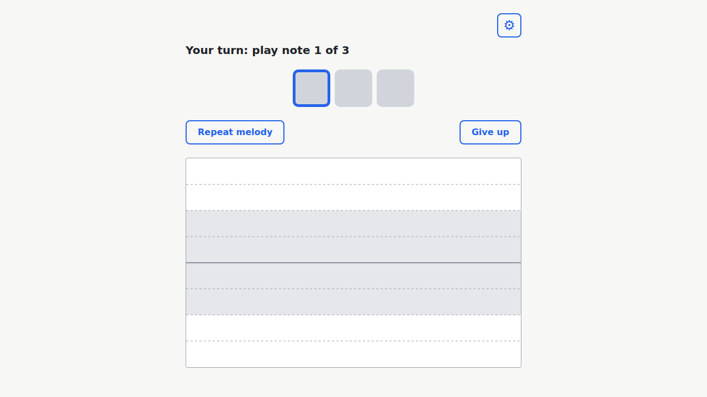

✅ **16. Reveal pause: Repeat disabled, Give up enabled, then Repeat back**

At green: Repeat disabled=true, Give up disabled=false; 200 ms later: Repeat disabled=true, Give up disabled=false; Repeat enabled again 507 ms after the green (expected ~500 ms, accepted 350–1000 ms).

Output: [P1-16-reveal-buttons.txt](run-2/output/P1-16-reveal-buttons.txt)

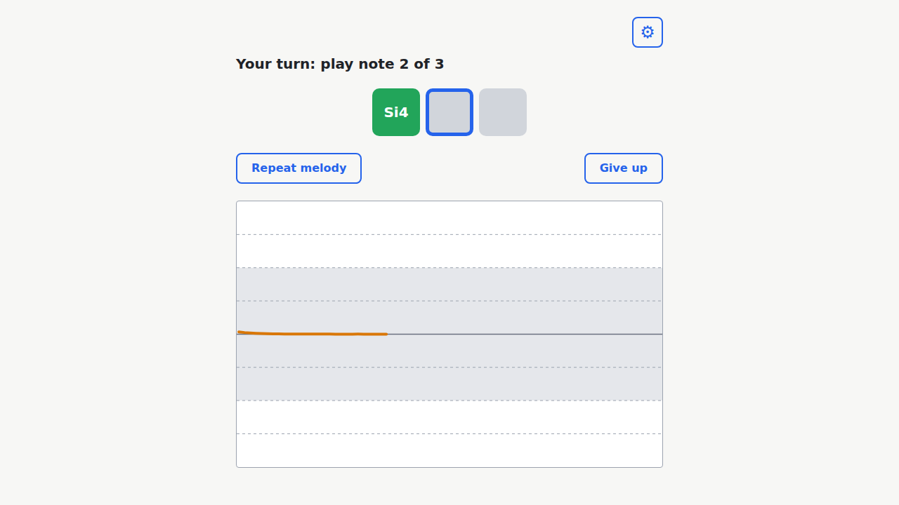

✅ **17. Continuous tone: boxes ~1 s apart, not every 0.5 s**

Continuous 440 Hz: box 1 after 564 ms, then intervals 1067 ms and 1064 ms (expected ~1 s = 0.5 s hold + 0.5 s reveal; accepted 850–1500 ms, i.e. clearly not every 0.5 s).

Output: [P1-17-continuous-tone-timing.txt](run-2/output/P1-17-continuous-tone-timing.txt)

✅ **18. Last note: "Well done!" at once, Home ~2 s later**

Status in the commit where box 3 turned green: "Well done!" (expected "Well done!"); Home 2004 ms after the last green (expected ~2000 ms, accepted 1700–3000 ms).

✅ **19. Give up during the reveal pause**

Clicked Give up 150 ms after the green (inside the reveal: Repeat disabled=true); Home after 3 ms (expected at once, ≤ 300 ms); still Home 3 s later: true; no page/console errors.

Output: [P1-19-give-up-during-reveal.txt](run-2/output/P1-19-give-up-during-reveal.txt)

### Wrong note (app, e2e mode)

✅ **20. Wrong note (440 Hz for Do5) does not advance**

After 2 s of 440 Hz on note 2 (Do5): boxes done/active/pending, status "Your turn: play note 2 of 3" (expected box 2 still active, "Your turn: play note 2 of 3"). The checklist's "no visual red mark yet" wording is obsolete since Part 2: this step is judged only on "nothing advances"; the graph band is now "red" (red expected after Part 2), card not shown.

Output: [P1-20-wrong-note-440-for-do5.txt](run-2/output/P1-20-wrong-note-440-for-do5.txt)

✅ **21. Right note (466.16 Hz) accepted as Do5**

466.16 Hz: box 2 green ("Do5") after 623 ms (expected ~500 ms, accepted 400–1500 ms); status "Your turn: play note 3 of 3".

Output: [P1-21-right-note-466.txt](run-2/output/P1-21-right-note-466.txt)

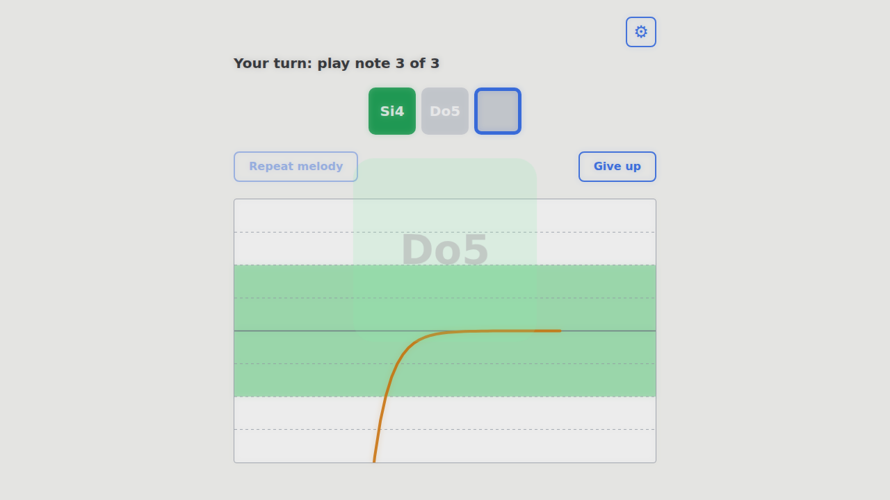

✅ **22. Octave error (220 Hz for Si4) does not advance**

After 2 s of 220 Hz: boxes active/pending/pending, status "Your turn: play note 1 of 3" (expected nothing advances). Control: 440 Hz then accepted after 597 ms.

Output: [P1-22-octave-error-220.txt](run-2/output/P1-22-octave-error-220.txt)

✅ **23. Repeat while stuck keeps progress; fresh 0.5 s hold**

Stuck before Repeat: boxes done/active/pending. Repeat replayed [440, 466.16, 466.16] Hz (expected [440, 466.16, 466.16]); box 1 during replay: done, at listening: done. With 466.16 Hz sounding throughout the replay, box 2 turned green 520 ms after listening resumed (fresh hold expected ~500 ms, accepted 400–1200 ms) as "Do5".

Output: [P1-23-repeat-keeps-progress.txt](run-2/output/P1-23-repeat-keeps-progress.txt)

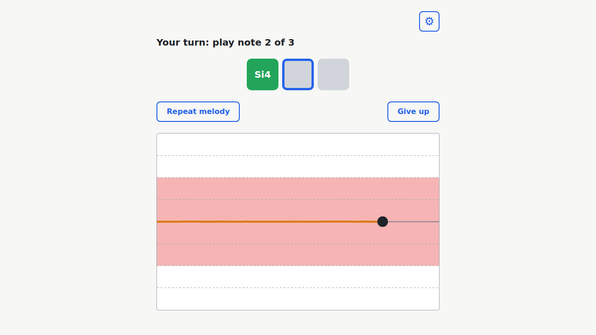

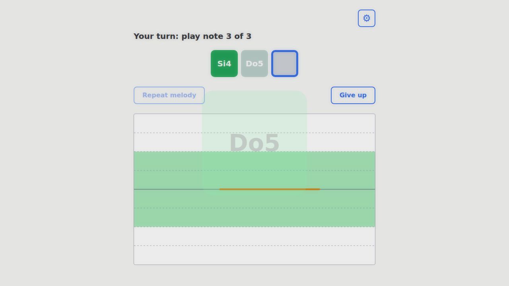

### Smoothing (app)

✅ **24. Vibrato / unsteady tone still accepted**

440 Hz with ±12 c vibrato at 5 Hz: accepted after 545 ms (expected ~500 ms, accepted 400–1200 ms).

Output: [P1-24-vibrato.txt](run-2/output/P1-24-vibrato.txt)

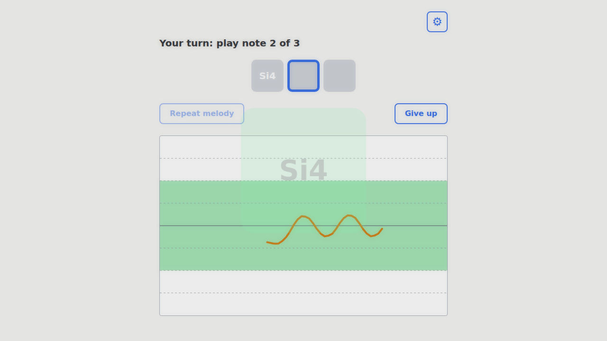

✅ **25. A gap in the middle restarts the hold**

After 300 ms tone / 150 ms silence / 300 ms tone: boxes active/pending/pending (expected no acceptance); then a continuous tone was accepted after 562 ms (expected ~500 ms, accepted 400–1200 ms).

Output: [P1-25-gap-restarts-hold.txt](run-2/output/P1-25-gap-restarts-hold.txt)

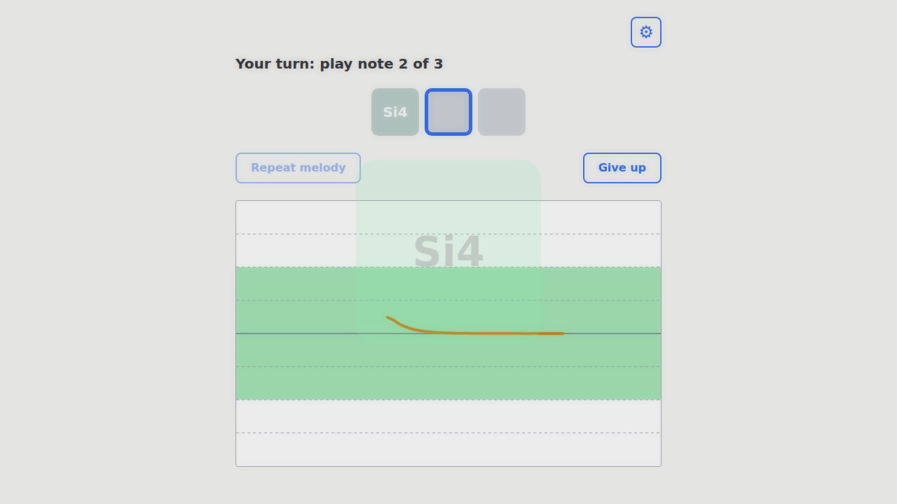

### Regressions

✅ **26. Regressions: live volume, full random exercise, production preview**

Live volume (5173, during "Listen…"): slider 50% → 80%; the running playback's master gain ramped to 0.8 (initial 0.5); playbacks before/after 2/2 (no restart); training dialog shows 2 sliders. OK.

Full random exercise (5 notes, concert 392, 440, 311.13, 311.13, 233.08 Hz, written La4 Si4 Fa4 Fa4 Do4): each note accepted after 567/1031/1052/1049/1049 ms (later notes include up to the 500 ms reveal pause); "Well done!", Home 2005 ms after the last green. No errors. OK.

Preview (http://localhost:4173/trumpet-trainer/): assets index-B9Zz1SD1.js, index-BMAYwom6.css loaded, no 4xx/5xx or errors; Start played 5 notes and reached "Your turn: play note 1 of 5". OK.

Output: [P1-26-dev-volume-and-play-through.txt](run-2/output/P1-26-dev-volume-and-play-through.txt), [P1-26-preview.txt](run-2/output/P1-26-preview.txt)

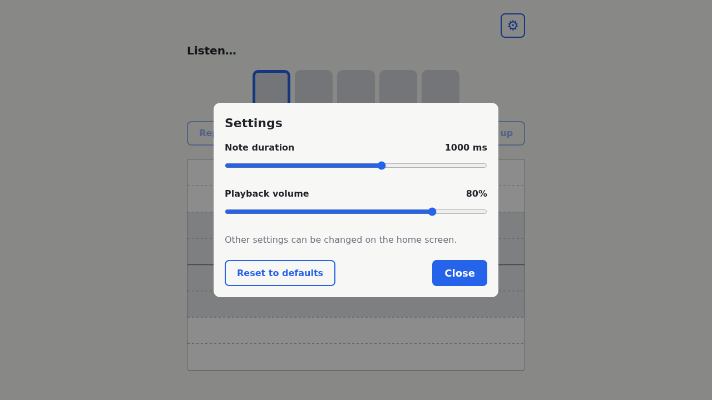

## New checks (prd2.md)

### Graph layout and empty state

✅ **1. Graph below the buttons: column width, grey band, centre line, 6 dashed guides, no text**

Graph top 286 px vs buttons bottom 262 px (below); width 608 px vs column 608 px; size 608 × 380.75 px, viewBox "0 0 320 200". Band y 50..150 of 200 (half the height), full width 320, fill rgb(229, 231, 235) (grey). Centre lines: 1 (y 100, dasharray none); guides: 6 at y 175/150/125/75/50/25 with dasharray 4px, 4px. Trail polylines 0, dots 0, fill false, <text> elements 0, text content "".

Output: [P2-01-graph-layout.txt](run-2/output/P2-01-graph-layout.txt)

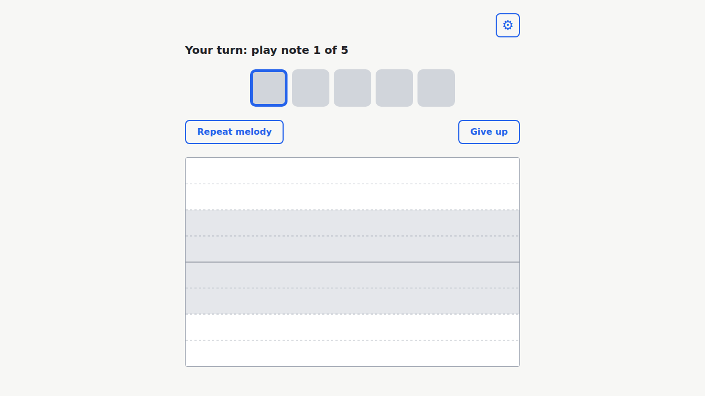

✅ **2. Graph is an <svg> with aria-hidden="true" and data-band-state="idle"**

<svg> aria-hidden="true" data-band-state="idle" (expected svg / "true" / "idle").

✅ **3. Graph stays empty during "Listen…" and "Get ready…"; nothing jumps**

440 Hz played from before Start. 318 frames sampled during "Listen…"/"Get ready…": dots 0, trails 0, fills 0, band states idle. Graph top across all phases 286–286 px (nothing jumps). Positive control: the dot appeared 0 ms after "Your turn".

Output: [P2-03-graph-during-playback-and-guard.txt](run-2/output/P2-03-graph-during-playback-and-guard.txt)

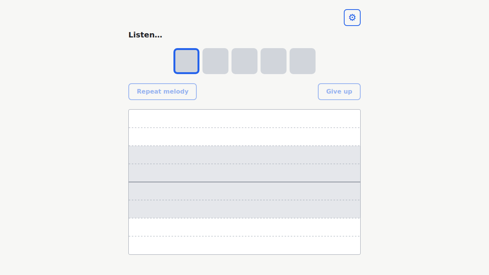

### Dot, trail and time scale

✅ **4. Dot at ~80 % width, up when sharp / down when flat, smooth; trail on the left only**

Dot cx always 256 of 320 (80 %; on screen 79.9 % of the graph width). +15 c: mean cy 69.9 (expected ≈ 70, above the centre 100 = up); −15 c: mean cy 129.8 (expected ≈ 130, down). Steady-tone smoothness: cy std dev 0.12 / 0.24, largest frame-to-frame step 0.12 / 0.24 units (no jitter). Trail: rightmost point ever x 256 (≤ 256: the 20 % right of the dot stays empty); after 1.5 s of tone the trail starts at x 0.18 (the full last second spans 0..256).

Output: [P2-04-graph-log.txt](run-2/output/P2-04-graph-log.txt)

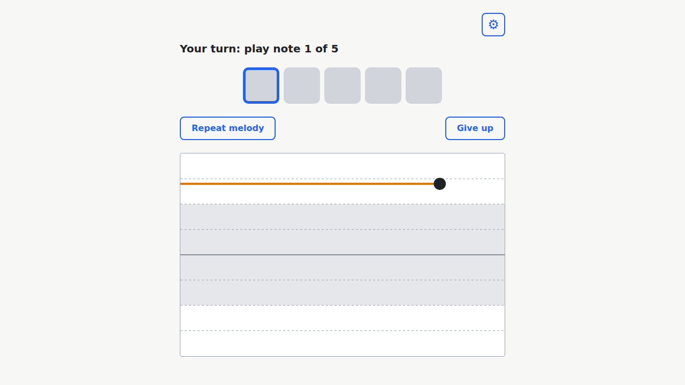

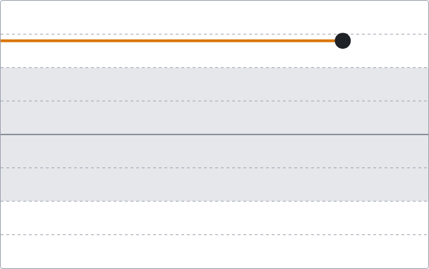

✅ **5. Silence: dot gone at once, trail gone ~1 s later, band keeps its colour**

After silence: dot removed 63 ms later (at once, ≤ 200 ms incl. audio/analyser latency); trail's right end scrolled left 256 → 4.38; trail gone 1044 ms after the tone stopped (expected ~1 s, accepted 850–1400 ms); band state during the 2 s: idle (grey).

✅ **6. Far out of tune / slide: trail leaves through the edge, graph re-centres on the neighbour**

+40 c steady: dot cy 20 (expected ≈ 20, outside the band 50..150), band idle. Slide 440·2^(30/1200) → 440·2^(70/1200) Hz over 2 s: 131 dot positions, 1 re-centre (dot cy 0.5 → 199.84: top edge to bottom edge); cy trend before -30.45, after -39.77 (both negative = still moving up); largest vertical step inside any trail polyline 1.86 units (≤ 100 = never across the graph); old trail clipped at the bottom edge after the wrap: true.

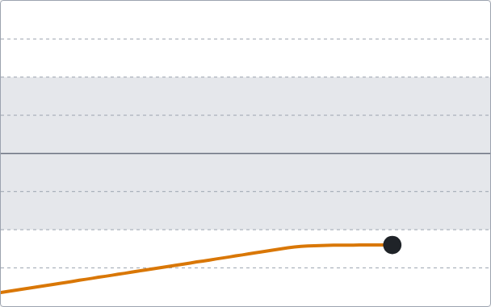

### Filling and correct note

✅ **7. In tune: band fills (muted yellow) to full width in ~0.5 s, state "filling"**

31 fill updates, all data-band-state "filling", width growing monotonically 3.84 → 316.48 of 320 in 506 ms (expected ~500 ms, accepted 380–800 ms), then green. Fill colour rgb(242, 220, 138) vs trail rgb(217, 119, 6) vs band rgb(229, 231, 235) (fill differs from both: true).

Output: [P2-07-graph-log.txt](run-2/output/P2-07-graph-log.txt)

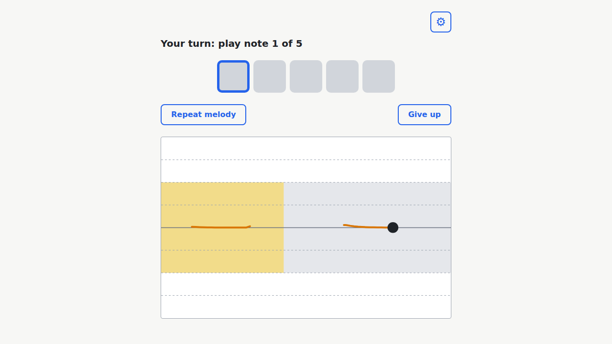

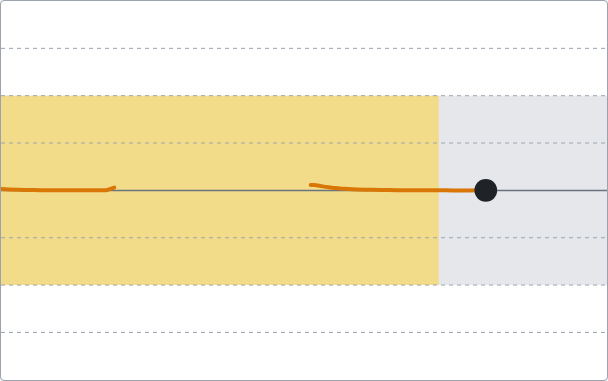

✅ **8. Out of tune or silence before 0.5 s: fill disappears at once**

Detune +40 c after 250 ms: fill reached 125.12/320, removed 91 ms after the detune (band "idle"). Stop after 250 ms: fill reached 128.06/320, removed 56 ms after the stop (band "idle"). No refill and no card afterwards. (At once = ≤ 200 ms, the smoother needs ~50 ms to cross ±25 c.)

✅ **9. Fill complete: green band + card "Si4" at once, dim + blur, box and status already advanced**

First card "Si4" appeared 4 ms after the band turned green (same commit expected, ≤ 50 ms); in that snapshot: band "green", boxes done/active/pending/pending/pending, box 1 "Si4", status "Your turn: play note 2 of 5". Dim layer: position fixed, 1280 × 720 px over a 1280 × 720 viewport, background rgba(0, 0, 0, 0.35), backdrop-filter blur(4px), z-index 10 (card 11); card centre (640, 360), 264.29 px wide (centred: true).

✅ **10. During the card: no dot, no fill, band stays green**

440 Hz kept sounding through 5 cards; 11 snapshots while a card was visible: fills 0, band states green (expected none / green). Dot: the dot of the completing frame (centred, cy 100) is still drawn when the card mounts and is removed by the next mic frame, 16 ms/15 ms/15 ms/15 ms/15 ms after each card appeared (≤ 50 ms = one frame accepted; not perceptible); no dot reappears during any card: true.

✅ **11. Card disappears after ~0.5 s; band grey; next note fills**

Card durations 510 ms, 501 ms, 504 ms, 502 ms, 508 ms (expected ~500 ms, accepted 400–700 ms). After each of cards 1–4: band left green 0 ms/0 ms/0 ms/0 ms after the card went (state idle), next note started filling after 92 ms/112 ms/75 ms/67 ms.

✅ **12. During the card: Repeat disabled, Give up enabled**

While a card was visible (11 snapshots over 5 cards): Repeat disabled true, Give up disabled false.

✅ **13. Five notes: card "Si4" each time, "Well done!", Home ~1.5 s after the last card**

5 cards: "Si4", "Si4", "Si4", "Si4", "Si4". At the fifth card: status "Well done!", boxes done/done/done/done/done. Home 1502 ms after the last card went (expected ~1.5 s, accepted 1200–2200 ms).

✅ **14. Give up clicked through the dimmed screen during the card**

Card "Si4" visible; elementFromPoint at Give up's centre is the button: true. Real mouse click (page.mouse.click, no force) delivered to "Give up" while card present=true / dim layer present=true; Home 6 ms later; still Home 2.5 s later: true. No errors.

Output: [P2-14-give-up-through-overlay.txt](run-2/output/P2-14-give-up-through-overlay.txt)

✅ **15. Card spelled exactly as the box (Fa#3 / Sol♭3 case)**

164.81 Hz on ?melody=54,66,71: card "Fa#3", first box "Fa#3" (state done) in the same snapshot; identical: true; accidental spelling: true.

Output: [P2-15-card-vs-box.txt](run-2/output/P2-15-card-vs-box.txt)

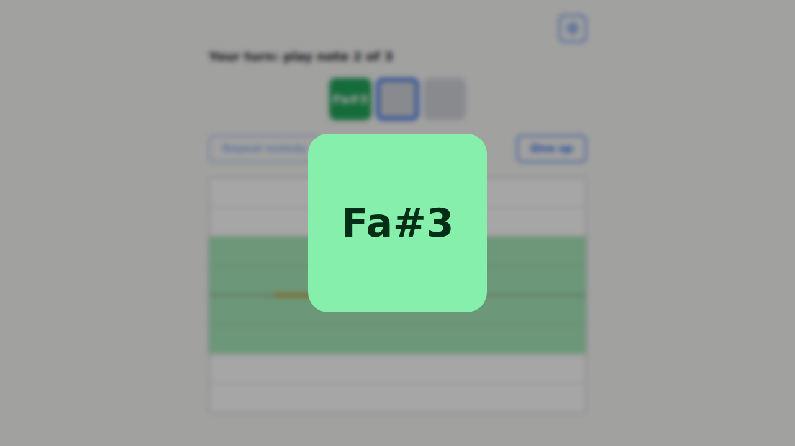

### Wrong notes (red band)

✅ **16. Wrong note: band fills then turns red; no card, nothing changes or is announced**

Note 2 (Do5) with 440 Hz: band filled (first fill 36.22) and turned red 454 ms after the fill started (expected ~0.5 s); fill on red: 0. Until silence: cards 0, status "Your turn: play note 2 of 3", boxes done/active/pending, status-region text "" (nothing announced: the status text never changed and the overlay region stayed empty).

Output: [P2-16-graph-log.txt](run-2/output/P2-16-graph-log.txt)

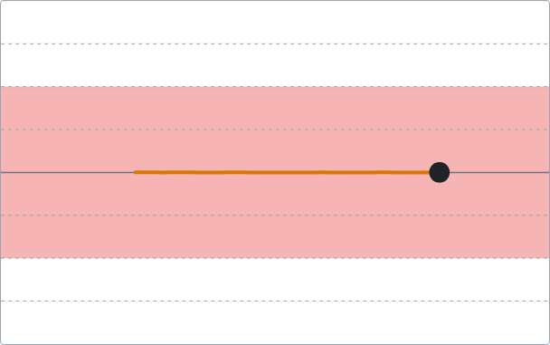

✅ **17. Holding the wrong note: band simply stays red**

2 more seconds of 440 Hz: 133 snapshots, band states red, cards 0, boxes done/active/pending.

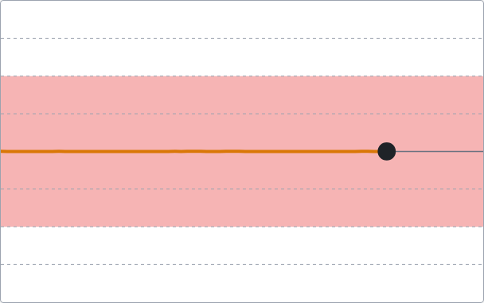

✅ **18. Silence after red: dot and trail go, band stays red**

Silence: dot gone after 69 ms, trail gone after 1036 ms; band states over the 2 s: red; at the end: band "red", dot null, trails 0.

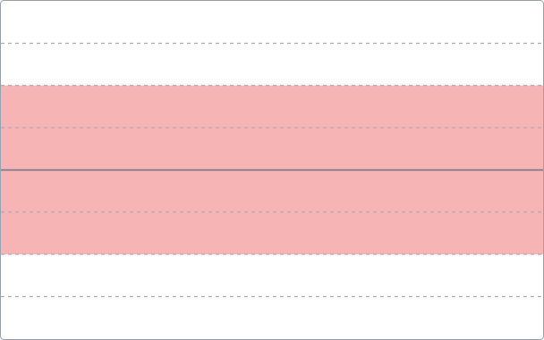

✅ **19. Repeat melody: band stays red throughout; wrong note red at once again**

Through "Your turn: play note 2 of 3" → "Listen…" → "Get ready…": band states red (63 snapshots). 440 Hz again for 1 s after listening resumed: dot shown true, filling ever false (expected red at once, no fill); box 1 stayed done.

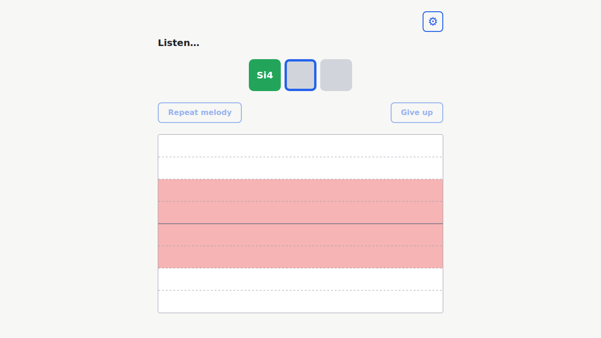

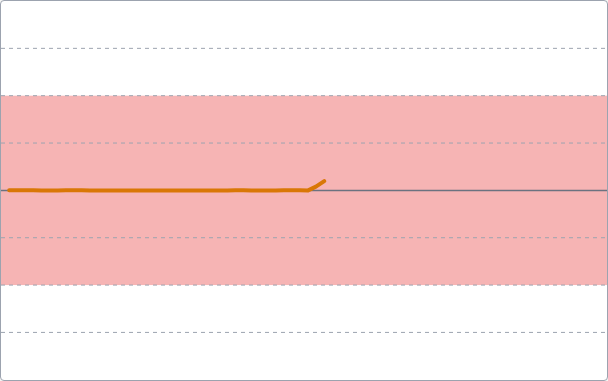

✅ **20. Right note after red: re-centres, fills, green, card "Do5"; red marks cleared**

466.16 Hz: band left red for "idle" (re-centred), filled (10.62…), card "Do5" with band "green", box 2 "Do5". After the card: band "idle"; 440 Hz on note 3 filled again (61 ms after the tone) before turning red (545 ms): red marks cleared.

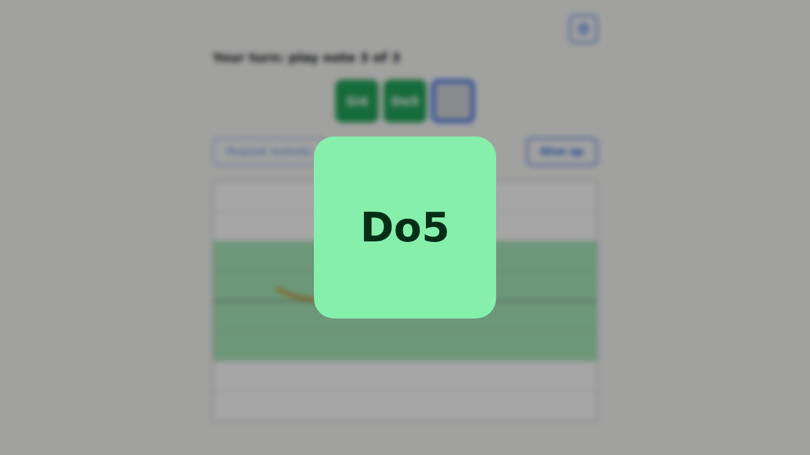

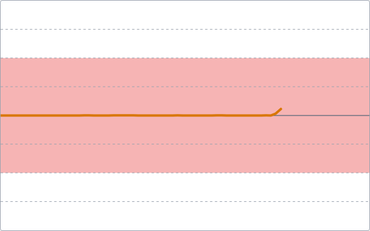

✅ **21. Octave error (220 Hz): red band, no card**

220 Hz on Si4: filled first (59 ms after the tone), red 559 ms after the tone; cards 0; boxes active/pending/pending; final band "red".

Output: [P2-21-graph-log.txt](run-2/output/P2-21-graph-log.txt)

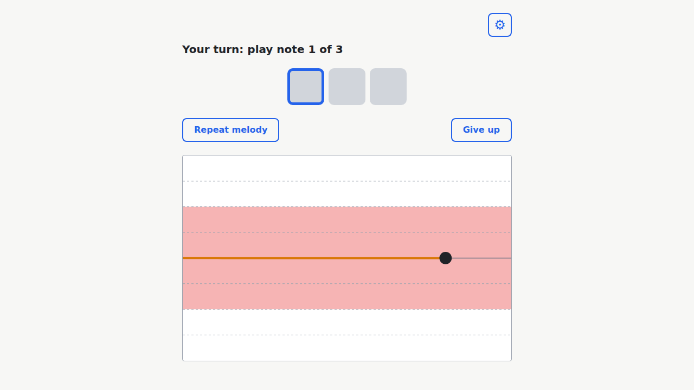

### Theme, width and motion

✅ **22. Dark theme colours**

prefers-color-scheme: dark (Playwright colorScheme). 13/13 computed colours equal their dark token: graphBg (dot-trail) rgb(17, 19, 23); graphBorder (dot-trail) rgb(212, 212, 212); band (dot-trail) rgb(95, 95, 95); centre (dot-trail) rgb(229, 229, 229); guide (dot-trail) rgb(212, 212, 212); trail (dot-trail) rgb(255, 225, 53); dot (dot-trail) rgb(255, 255, 255); fill (filling) rgb(92, 77, 22); band (card) rgb(47, 94, 50); card (card) rgb(134, 255, 107); cardText (card) rgb(11, 11, 11); backdrop (card) rgba(0, 0, 0, 0.6); band (red) rgb(92, 16, 16). Band states captured: idle/filling/green/red. Contrast: card text 15.49:1, dot 18.59:1, trail 14.23:1 on the graph background. The checklist's colour words (e.g. "bright yellow trail, white dot, olive fill") are judged by the tokens and the screenshots.

Output: [P2-22-dark-colours.txt](run-2/output/P2-22-dark-colours.txt)

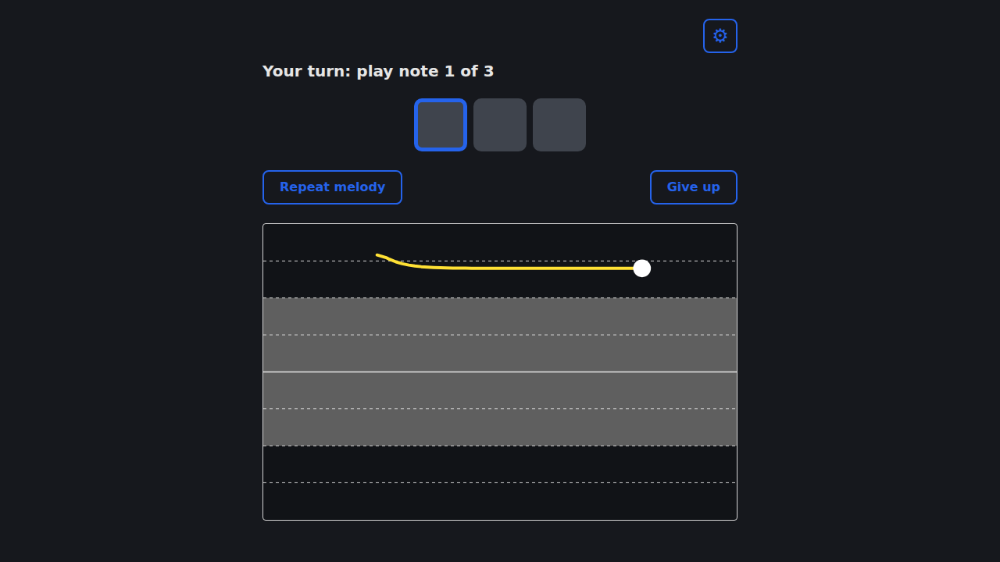

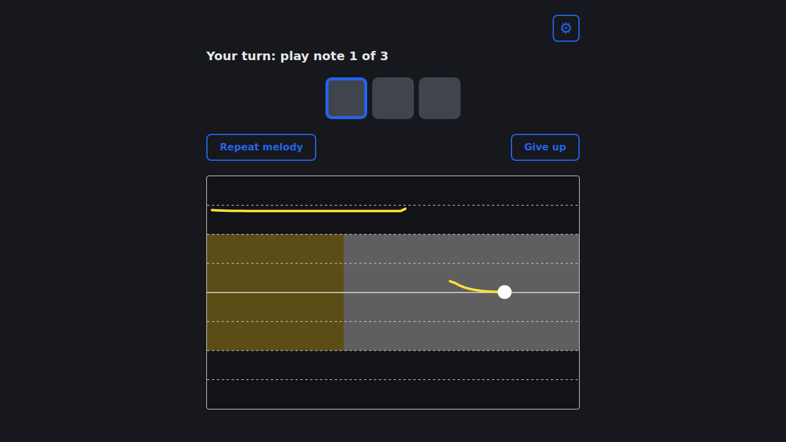

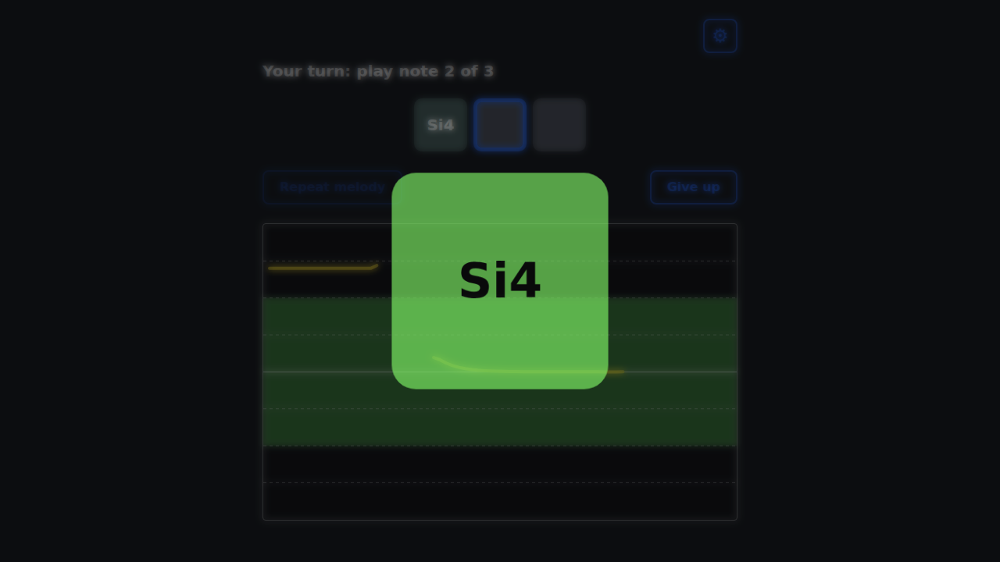

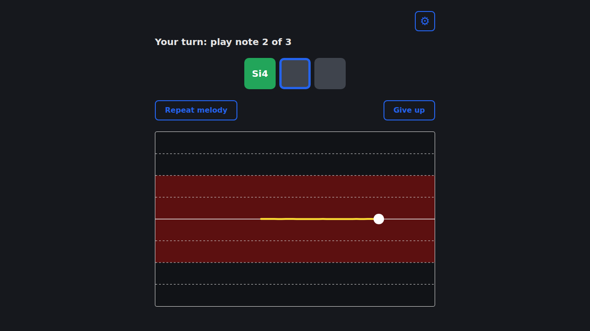

✅ **23. Light theme colours**

prefers-color-scheme: light (Playwright colorScheme). 13/13 computed colours equal their light token: graphBg (dot-trail) rgb(255, 255, 255); graphBorder (dot-trail) rgb(156, 163, 175); band (dot-trail) rgb(229, 231, 235); centre (dot-trail) rgb(107, 114, 128); guide (dot-trail) rgb(156, 163, 175); trail (dot-trail) rgb(217, 119, 6); dot (dot-trail) rgb(31, 35, 40); fill (filling) rgb(242, 220, 138); band (card) rgb(167, 232, 184); card (card) rgb(134, 239, 172); cardText (card) rgb(5, 46, 22); backdrop (card) rgba(0, 0, 0, 0.35); band (red) rgb(246, 180, 180). Band states captured: idle/filling/green/red. Contrast: card text 10.62:1, dot 15.8:1, trail 3.19:1 on the graph background. 13/13 measured colours differ from the dark run. The checklist's colour words (e.g. "amber trail, dark dot, pale gold fill") are judged by the tokens and the screenshots.

Output: [P2-23-light-colours.txt](run-2/output/P2-23-light-colours.txt)

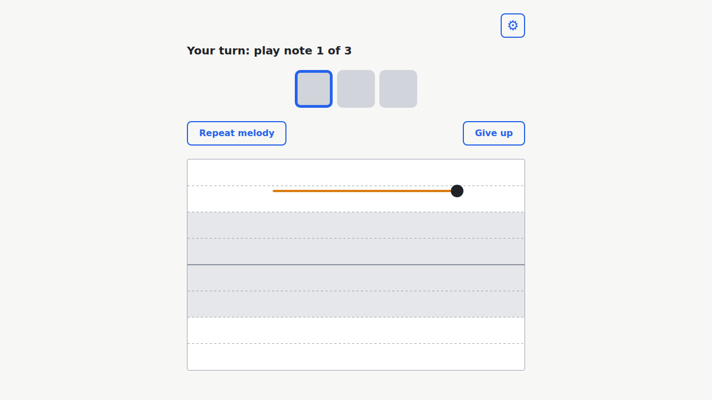

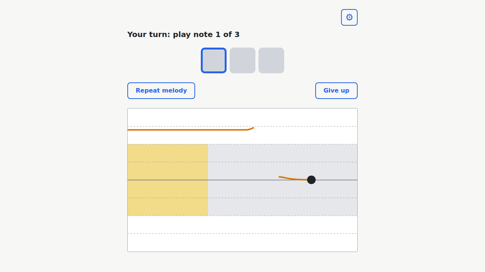

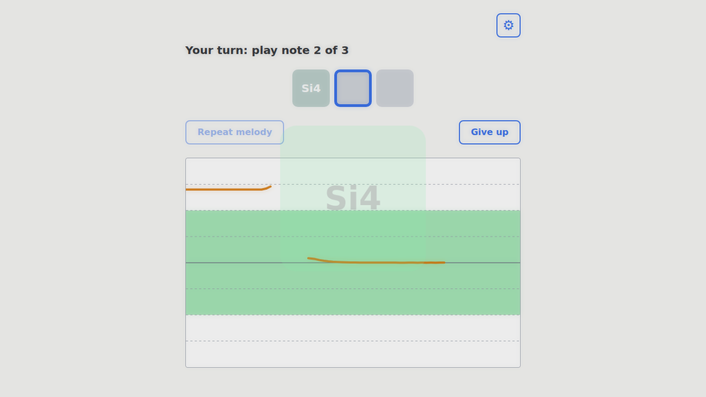

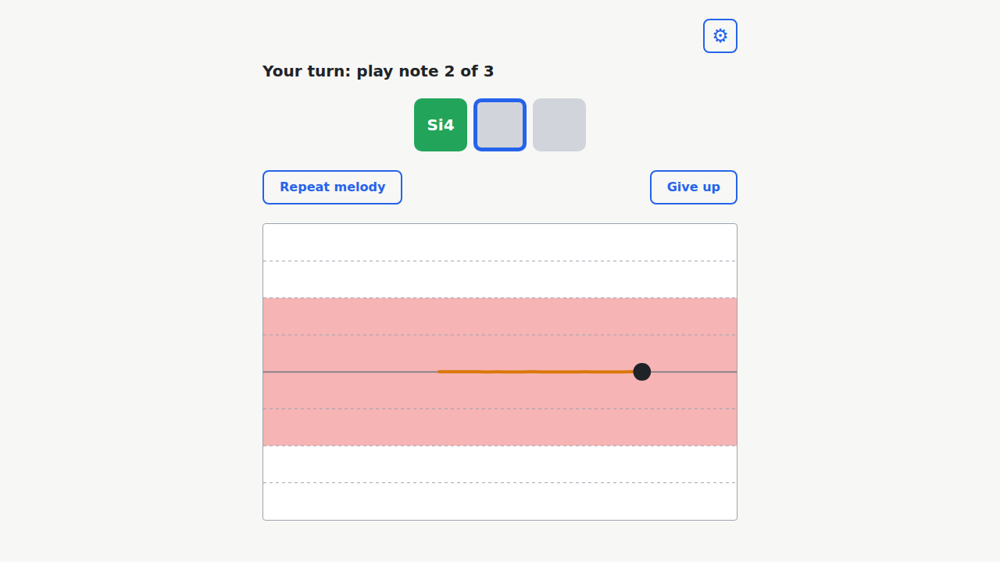

✅ **24. 320 px width: graph ~288 × 180, no horizontal scroll, card on screen**

Viewport 320 × 640: graph 288 × 180.75 px at x 16 (expected ≈ 288 × 180); scrollWidth/clientWidth 320/320 (listening), 320/320 (card) → no horizontal scroll; card 40..280 × 200..440 (inside the viewport: true).

Output: [P2-24-320px-layout.txt](run-2/output/P2-24-320px-layout.txt)

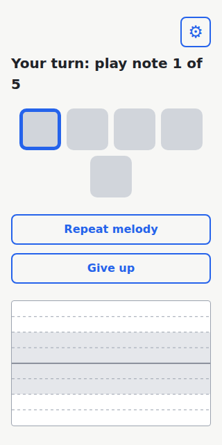

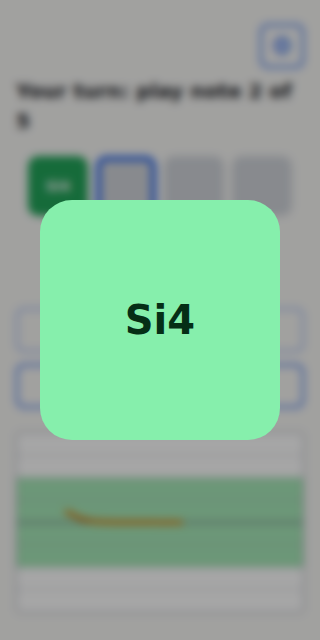

✅ **25. Reduced motion: dim layer and card appear without animation**

prefers-reduced-motion: reduce. At insertion: card animation-name "none", 0 running animations, opacity 1; dim layer animation-name "none", 0 running, opacity 1 (appear instantly).

Output: [P2-25-reduced-motion.txt](run-2/output/P2-25-reduced-motion.txt)

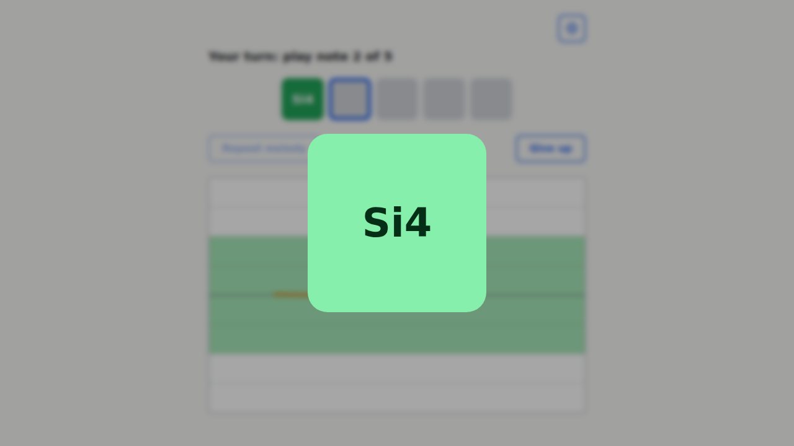

✅ **26. Without reduced motion: fade + pop on appear, no exit animation**

No reduced motion. At insertion: dim layer "note-reveal-fade" 0.12s (1 running), card "note-reveal-pop" 0.15s (1 running) — keyframes: fade from opacity 0; pop from opacity 0 + scale(0.9). Exit: both elements removed from the DOM in one commit (503 ms after appearing), 0 leftovers, transition-duration 0s/0s → no exit animation.

Output: [P2-26-motion.txt](run-2/output/P2-26-motion.txt)

✅ **27. Gear during the card: Settings dialog opens above the dim layer and works**

Gear clicked with the real mouse while the card "Si4" was shown (card present at the click: true); elementFromPoint at the gear: gear true. Settings dialog opened (modal, top layer: element at its centre belongs to the dialog = true). Sliders worked: volume 80%, note duration 500 ms; Close closed it. Training continued: status "Your turn: play note 2 of 5", next note gave card "Si4".

Output: [P2-27-settings-during-card.txt](run-2/output/P2-27-settings-during-card.txt)

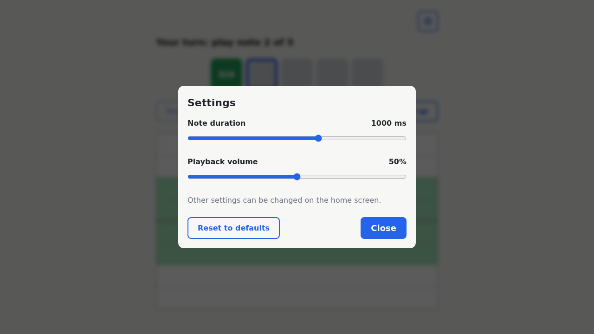

### Random melodies and regressions

✅ **28. Random melody (5173): dot follows, fill, green card with the right name, wrong notes red**

Random melody of 5 notes (concert 311.13, 261.63, 220, 174.61, 349.23 Hz, written Fa4 Re4 Si3 Sol3 Sol4). Note 1 at +15 c: mean dot cy 69.79 (σ 0.21), at −15 c: 129.95 (σ 0.02) → up/down, smooth. Fill-to-card times 482 ms/484 ms/500 ms/500 ms/438 ms (~0.5 s). Cards "Fa4", "Re4", "Si3", "Sol3", "Sol4" equal the box names: true. Wrong notes (a semitone below notes 2 and 3) turned red, 0 cards.

Output: [P2-28-random-melody-log.txt](run-2/output/P2-28-random-melody-log.txt)

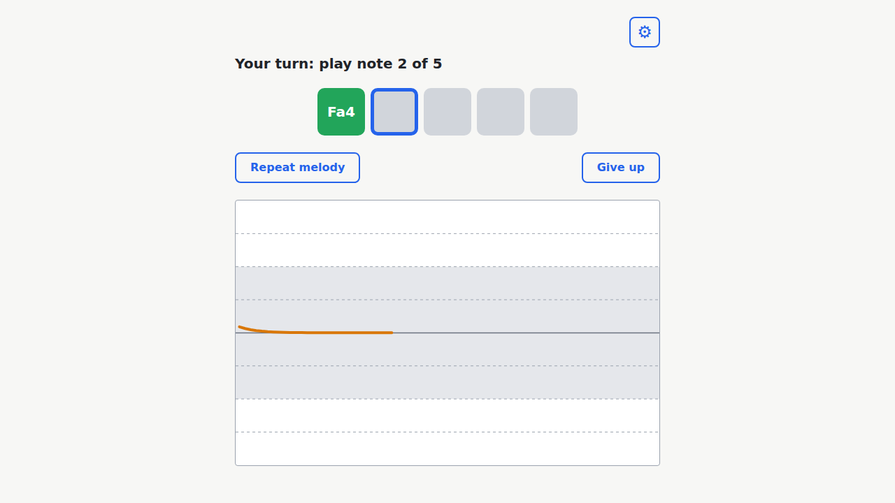

✅ **29. Random melody: red kept through Repeat; correct note → card, then grey and listening**

Through Repeat ("Your turn: play note 2 of 5" → "Listen…" → "Get ready…"): band red; the wrong note again: red at once (filling ever: false). Correct note → card "Re4" (box "Re4"); after it: band "idle", status "Your turn: play note 3 of 5", Repeat enabled true (listening resumed).

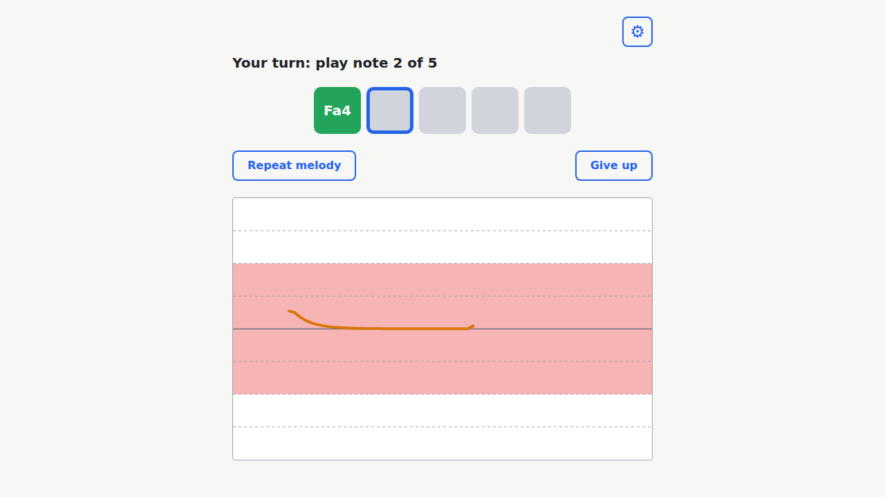

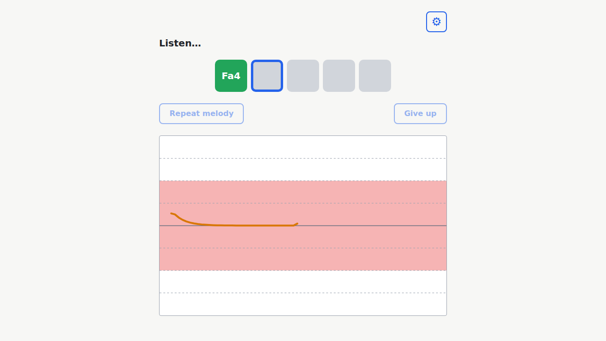

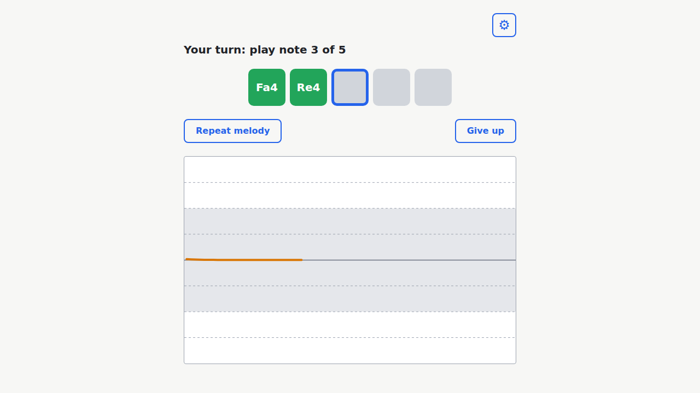

✅ **30. Random melody: slide to the neighbour wraps without jumping across**

Slide on note 3 (220 Hz) from +30 c to +70 c over 2 s: 1 re-centre (dot cy 0.28 → 199.58), trend before -37.62 / after -39.5 (same direction), largest vertical step in any trail polyline 0.75 units (≤ 100: no jump across), old trail clipped at the edge: true.

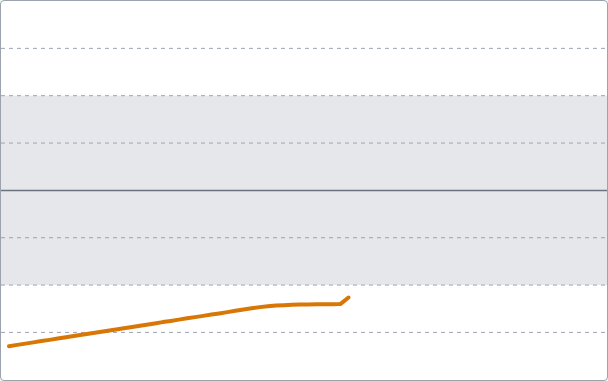

✅ **31. Live volume + note duration on Repeat; progress, red marks and graph kept**

Settings during listening (note 3 red): note duration 500 ms, volume 80%. Repeat: playback #4 started at volume 0.8 with note spacing 500 ms (first playback 1000 ms). Volume → 30 % during that replay: master gain ramp to 0.3 recorded 13 ms after the slider change (includes the Playwright fill round-trip), no restart (4 playbacks in total). During the replay: band red, boxes done/done/active/pending/pending (progress and red kept). Graph kept working: glide drawn and note 3 card "Si3".

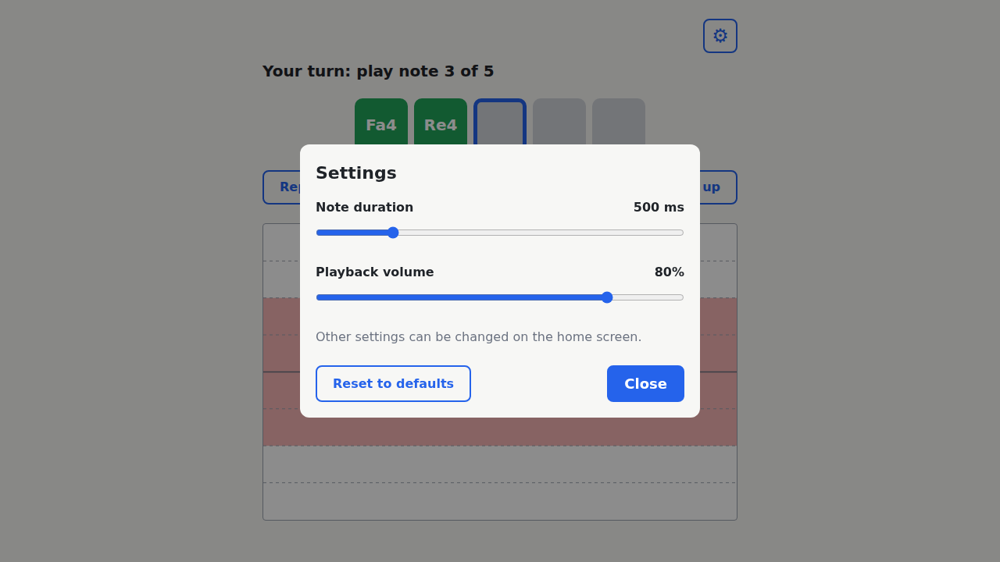

✅ **32. Production preview shows the graph and the overlay with the same colours and behaviour**

Preview http://localhost:4173/trumpet-trainer/ (light scheme), 5-note random melody: graph aria-hidden=true, band idle at listening; 5 cards ("Re4", "Do5", "Sol4", "Si3", "Re4"; boxes "Re4", "Do5", "Sol4", "Si3", "Re4") matching the boxes in the same commit: true. Colours: graph bg rgb(255, 255, 255); band rgb(229, 231, 235); fill rgb(242, 220, 138); trail rgb(217, 119, 6); green band rgb(167, 232, 184); card rgb(134, 239, 172); card text rgb(5, 46, 22); dim layer rgba(0, 0, 0, 0.35). No errors.

Output: [P2-32-preview.txt](run-2/output/P2-32-preview.txt)

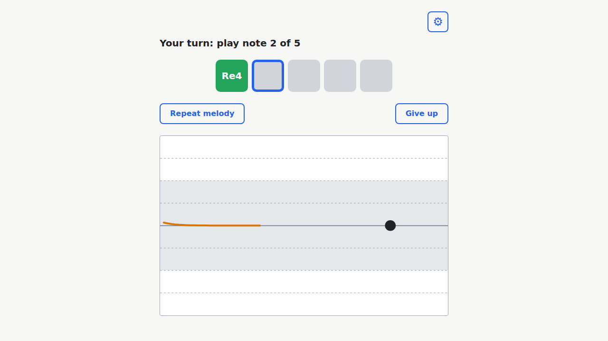

### Phone and accessibility

⏭️ **33. Phone (iOS Safari / Android Chrome): dim + blur, card, Give up tap**

Manual: needs a real phone (iOS Safari + Android Chrome over HTTPS). Partial automated evidence: src/styles.css has -webkit-backdrop-filter: blur(4px) next to backdrop-filter: true. Production CSS index-BMAYwom6.css contains -webkit-backdrop-filter: true, backdrop-filter: true. Chromium phone emulation (Pixel 7, 412 × 839, touch): card inside the viewport true, Give up hit-test true, touchscreen tap during the card → Home true.

Output: [P2-33-phone-partial.txt](run-2/output/P2-33-phone-partial.txt)

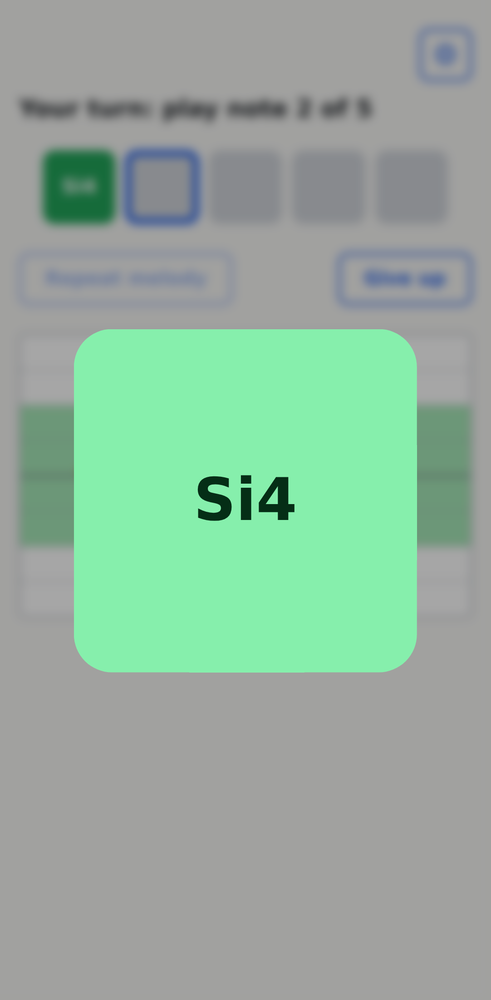

⏭️ **34. Screen reader: name announced once, graph silent, wrong notes never announced**

Manual: needs a real screen reader (VoiceOver / TalkBack / NVDA). Partial automated evidence: At the card: role="status" region text "Si4", status (aria-live="polite") already "Your turn: play note 2 of 3"; graph aria-hidden=true, dim layer aria-hidden=true. Region text sequence "" → "Si4" → "" (set once per card); status sequence "Your turn: play note 1 of 3" → "Your turn: play note 2 of 3" (the wrong note added no text). Accessibility tree during red mentions the graph: false (see the ariaSnapshot in the output file).

Output: [P2-34-a11y-partial.txt](run-2/output/P2-34-a11y-partial.txt)

## Comparison with previous run

Run 1 ([validation-report-run-1.md](validation-report-run-1.md)) covered only Part 1 (prd.md); every prd2.md step is new in this run.

No status changes: all 26 re-run prd.md steps have the same status as in Run 1.

New prd2.md steps: 32 PASS, 0 FAIL, 2 SKIP.

